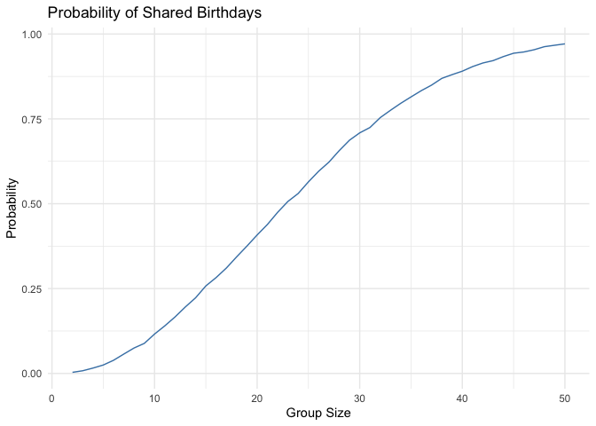
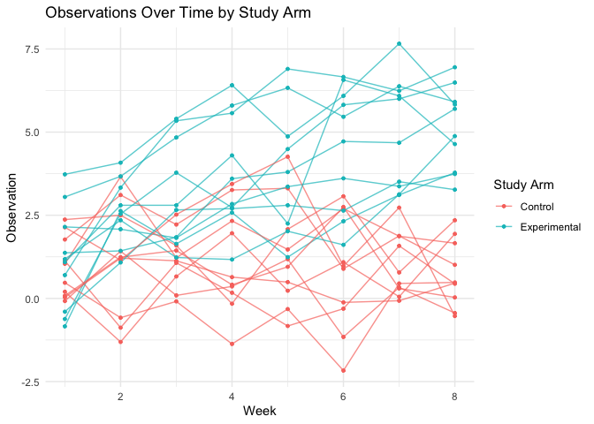
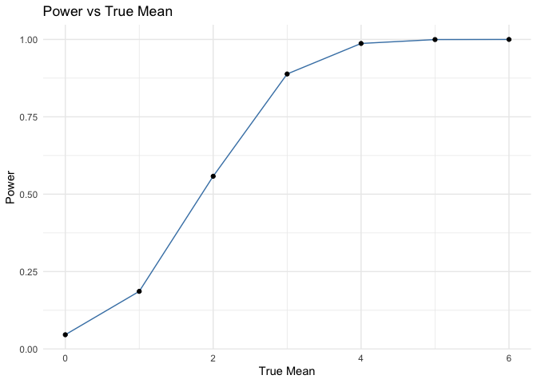
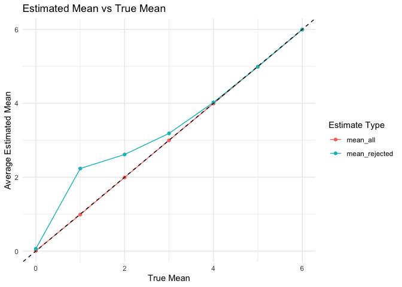

p8105_hw5_yx3108
================
Yahan Xue
2026-11-16

``` r
library(tidyverse)
```

    ## ── Attaching core tidyverse packages ──────────────────────── tidyverse 2.0.0 ──
    ## ✔ dplyr     1.2.1     ✔ readr     2.2.0
    ## ✔ forcats   1.0.1     ✔ stringr   1.6.0
    ## ✔ ggplot2   4.0.3     ✔ tibble    3.3.1
    ## ✔ lubridate 1.9.5     ✔ tidyr     1.3.2
    ## ✔ purrr     1.2.2     
    ## ── Conflicts ────────────────────────────────────────── tidyverse_conflicts() ──
    ## ✖ dplyr::filter() masks stats::filter()
    ## ✖ dplyr::lag()    masks stats::lag()
    ## ℹ Use the conflicted package (<http://conflicted.r-lib.org/>) to force all conflicts to become errors

``` r
library(broom)

set.seed(123)


birthday_sim = function(n) {
  birthdays = sample(1:365, size = n, replace = TRUE)

  any(duplicated(birthdays))
}


birthday_results = tibble(
  group_size = 2:50
) |>
  mutate(
    prob = map_dbl(
      group_size,
      \(n) mean(replicate(10000, birthday_sim(n)))
    )
  )


birthday_results |>
  ggplot(aes(x = group_size, y = prob)) +
  geom_line(color = "steelblue") +
  labs(
    title = "Probability of Shared Birthdays",
    x = "Group Size",
    y = "Probability"
  ) +
  theme_minimal()
```

<!-- -->

The probability of sharing a birthday increases as group size increases.
With around 23 people, the probability is approximately 50%. For larger
groups, the probability approaches 1.

``` r
longitudinal_df = tibble(
  file_name = list.files(
    path = "data",
    pattern = "\\.csv$",
    full.names = TRUE
  )
)


longitudinal_df = longitudinal_df |>
  mutate(
    data = map(file_name, read_csv, show_col_types = FALSE)
  )


longitudinal_df = longitudinal_df |>
  mutate(
    file_name = basename(file_name),
    arm = str_extract(file_name, "^(con|exp)"),
    subject_id = str_extract(file_name, "\\d+")
  ) |>
  select(-file_name) |>
  unnest(data) |>
  pivot_longer(
    cols = starts_with("week_"),
    names_to = "week",
    values_to = "observation"
  ) |>
  mutate(
    arm = recode(
      arm,
      "con" = "Control",
      "exp" = "Experimental"
    ),
    week = as.numeric(str_remove(week, "week_"))
  )


longitudinal_df |>
  ggplot(
    aes(
      x = week,
      y = observation,
      group = interaction(arm, subject_id),
      color = arm
    )
  ) +
  geom_line(alpha = 0.7) +
  geom_point(size = 1) +
  labs(
    title = "Observations Over Time by Study Arm",
    x = "Week",
    y = "Observation",
    color = "Study Arm"
  ) +
  theme_minimal()
```

<!-- -->

The experimental group generally shows an increasing trend over time,
while the control group remains relatively stable. The experimental
group also has higher observations overall.

``` r
sim_t_test = function(mu) {

  sim_data = rnorm(
    n = 30,
    mean = mu,
    sd = 5
  )

  t.test(sim_data, mu = 0) |>
    broom::tidy() |>
    select(estimate, p.value)
}

sim_results = expand_grid(
  true_mu = 0:6,
  iter = 1:5000
) |>
  mutate(
    results = map(true_mu, sim_t_test)
  ) |>
  unnest(results)


power_results = sim_results |>
  group_by(true_mu) |>
  summarize(
    power = mean(p.value < 0.05),
    .groups = "drop"
  )

power_results |>
  ggplot(aes(x = true_mu, y = power)) +
  geom_line(color = "steelblue") +
  geom_point() +
  labs(
    title = "Power vs True Mean",
    x = "True Mean",
    y = "Power"
  ) +
  theme_minimal()
```

<!-- -->

``` r
mean_results = sim_results |>
  group_by(true_mu) |>
  summarize(
    mean_all = mean(estimate),
    mean_rejected = mean(estimate[p.value < 0.05]),
    .groups = "drop"
  )

mean_results |>
  pivot_longer(
    cols = c(mean_all, mean_rejected),
    names_to = "estimate_type",
    values_to = "mean_estimate"
  ) |>
  ggplot(
    aes(
      x = true_mu,
      y = mean_estimate,
      color = estimate_type
    )
  ) +
  geom_line() +
  geom_point() +
  geom_abline(
    slope = 1,
    intercept = 0,
    linetype = "dashed"
  ) +
  labs(
    title = "Estimated Mean vs True Mean",
    x = "True Mean",
    y = "Average Estimated Mean",
    color = "Estimate Type"
  ) +
  theme_minimal()
```

<!-- -->

``` r
power_results = sim_results |>
  group_by(true_mu) |>
  summarize(
    power = mean(p.value < 0.05),
    .groups = "drop"
  )
```

(1)As the effect size increases, the power also increases. Larger
effects are more likely to be detected.

(2)They are not always equal. When the true mean is small and positive,
the average estimate among rejected tests is higher than the true mean.
Because significant tests tend to have more extreme estimates. As the
true mean increases, the difference becomes smaller.
